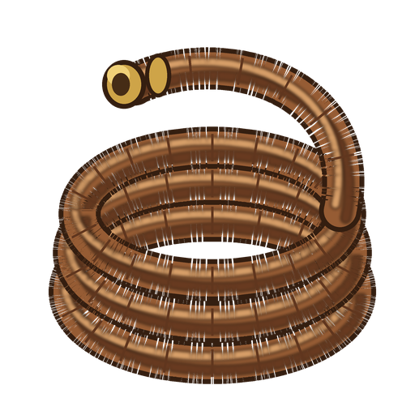

# Kegeln – ein Mod für Anno 117: Pax Romana

<p align="center"></p>

Bringt das Kegeln ins Römische Reich: Trichter als neue Ware mit eigenen Produktionsketten in allen drei Welten,
ein passendes Bedürfnis für die Bevölkerung, Lieferaufträge an den Leuchttürmen und einen Kaiser, der ab und an
zu einer Runde einlädt.

Stand: Version 0.1.0, erste Testversion für Spielversion 3.0.x. Was im Spiel schon geprüft ist und was nicht,
steht unter [Teststand](#teststand).

## Download und Installation

1. Die Datei `kegeln-v0.1.0.zip` von der [Release-Seite](../../releases/latest) herunterladen.
2. Entpacken. Im Archiv liegt ein Ordner `kegeln`.
3. Diesen Ordner nach `Dokumente\Anno 117 - Pax Romana\mods\` kopieren, sodass
   `Dokumente\Anno 117 - Pax Romana\mods\kegeln\modinfo.json` existiert.
4. Spiel starten. Neu abgelegte Mods sind automatisch aktiv.

Der Mod funktioniert mit bestehenden Spielständen; ein neues Spiel ist nicht nötig.

**Mehrspieler:** Alle Mitspieler brauchen dieselbe Version des Mods.

**Entfernen:** Sobald in einem Spielstand Trichter-Gebäude stehen oder Trichter im Lager liegen, sollte der Mod
für diesen Spielstand aktiv bleiben.

## Was der Mod bringt

### Neue Waren

| | Ware | Verwendung |
|---|---|---|
|  | Trichter | Bedürfnis der Bevölkerung, Lieferaufträge |
|  | Schläuche | Zwischenprodukt für Trichter |

Malz und Bier lassen sich zusätzlich in Latium herstellen.

### Bedürfnis

Alle Bewohner ab der 2. Stufe haben in jeder Welt das optionale Bedürfnis nach Trichtern:
+3 Zufriedenheit, +1 Geld, −1 Wissen.

### Produktionsketten

Im Baumenü der 2. Stufe unter „Kegel-Produktion“. Alle Gebäude sind sofort verfügbar.

**Latium**

| Gebäude | Rezept | Takt |
|---|---|---|
| Mälzerei | Weizen → Malz | 1:00 |
| Brauerei | Malz → Bier | 1:00 |
| Schlauchmacher | Leder → Schläuche | 1:00 |
| Trichter-Werkstatt | Bier + Amphoren + Schläuche → Trichter | 1:00 |

**Albion**

| Gebäude | Rezept | Takt |
|---|---|---|
| Schlauchmacher | Schilf → Schläuche | 1:00 |
| Trichter-Werkstatt | Bier + Trinkhörner + Schläuche → Trichter | 1:00 |

**Ägypten**

| Gebäude | Rezept | Takt |
|---|---|---|
| Schlauchmacher | Schilf → Schläuche | 1:00 |
| Trichter-Werkstatt | Bier + Öllampen + Schläuche → Trichter | 1:00 |

Umfeld-Wirkung: Die Trichter-Werkstatt gibt +1 Ansehen in ihrem Radius. Die Brauerei in Latium senkt die
Brandsicherheit um 2 und bringt +1 Geld, wie die Brauerei in Albion. Nur die Brauerei in Latium verbraucht Kohle.

### Lieferaufträge an den Leuchttürmen

Händler, Piraten und Rivalen verlangen in ihren Lieferaufträgen gelegentlich Trichter (rund 13 % der
Lieferaufträge). Menge und Belohnung berechnet das Spiel wie bei allen anderen Aufträgen.

### Der Kaiser kegelt

In zufälligen Abständen von 30 bis 90 Minuten lädt der Kaiser zum Kegeln ein. Wer zusagt, erhält +1 Ansehen
beim Kaiser und 5.000 Denare.

## Teststand

Im Spiel geprüft (Einzelspieler, bestehender Spielstand):

- Die Kaiser-Einladung erscheint als Statthalter-Anfrage und lässt sich annehmen.
- Die Gebäude stehen im Baumenü und lassen sich platzieren, Rezepte und Taktzeiten stimmen.
- Die Umfeld-Wirkung der Trichter-Werkstatt.

Noch nicht geprüft:

- Mehrspieler.
- Ob die neuen Waren im Kontor und bei den Bedürfnissen korrekt angezeigt werden.
- Ob Trichter-Lieferaufträge an den Leuchttürmen tatsächlich auftauchen.
- Der Zufalls-Timer der Kaiser-Einladung und die Belohnung.
- Ägypten insgesamt (benötigt das DLC).

Bekannte Einschränkungen:

- Die Gebäude nutzen die Modelle vorhandener Gebäude: Die Mälzerei in Latium sieht aus wie eine Bäckerei, die
  Brauerei wie ein Winzer.
- Der Timer der Kaiser-Einladung zählt die Zeit seit dem Spielstart und beginnt nach jedem Neustart von vorn.
- Die Texte gibt es auf Deutsch und Englisch.

Fehler bitte als [Issue](../../issues) melden, am besten mit der Datei
`Dokumente\Anno 117 - Pax Romana\mods\mod-loader.log`.

## Selbst bauen

Der Mod wird aus Skripten erzeugt. Voraussetzung ist Python 3.9 oder neuer, ohne Zusatzpakete.

```
python scripts/build.py --zip
```

Das Ergebnis liegt in `dist/kegeln`, das Archiv in `dist/kegeln-v<Version>.zip`.

| Option | Wirkung |
|---|---|
| `--install <Ordner>` | kopiert den Mod zusätzlich in den angegebenen `mods`-Ordner |
| `--dev` | fügt Test-Tasten hinzu: Umschalt+F6 öffnet die Kaiser-Einladung sofort, Umschalt+F7 führt ein Testskript aus |
| `--version <x.y.z>` | setzt die Versionsnummer |
| `--vanilla-assets <Datei>` | liest die Vorlagen neu aus der `assets.xml` des Spiels |

### Aufbau

| Pfad | Inhalt |
|---|---|
| `scripts/build.py` | Einstieg, ruft die drei Teile nacheinander auf |
| `scripts/build_base.py` | `modinfo.json`, Kaiser-Einladung, Timer |
| `scripts/build_trichter.py` | Waren, Bedürfnis, Gebäude, Umfeld-Wirkung, Baumenü |
| `scripts/build_contracts.py` | Trichter in den Lieferaufträgen |
| `scripts/vanilla_templates.json` | Vorlagen aus den Spieldaten, auf denen die neuen Gebäude aufbauen |
| `assets/icons/` | Icons und die Skripte, die sie zeichnen (benötigen Pillow) |

Die neuen Gebäude sind angepasste Kopien von Originalgebäuden. Der Mod nutzt GUIDs und Text-IDs aus dem Bereich
2001000000 bis 2001009999, der für private Mods vorgesehen ist.

Dokumentation des Mod-Loaders: <https://jakobharder.github.io/anno-mod-loader/>
